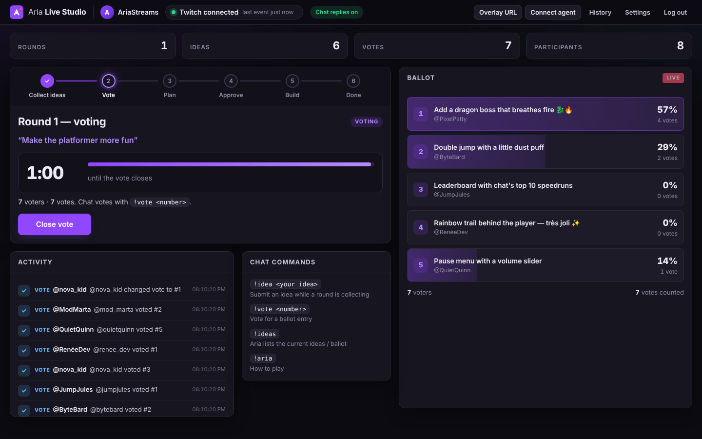
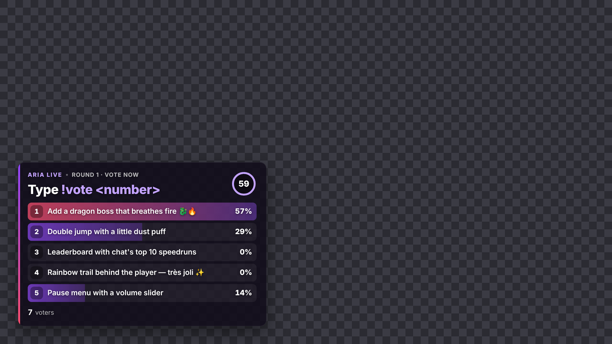
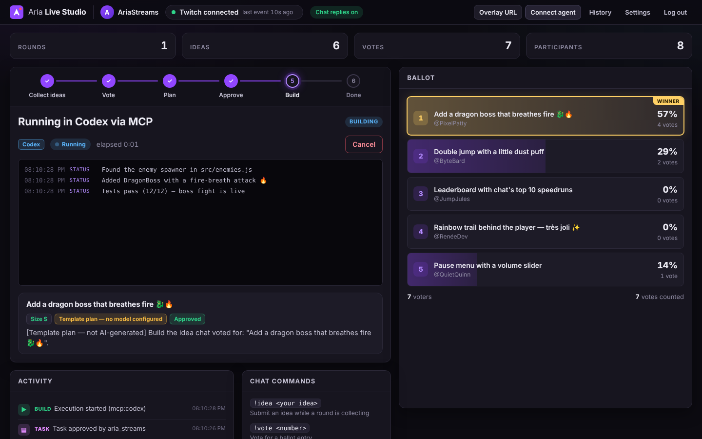
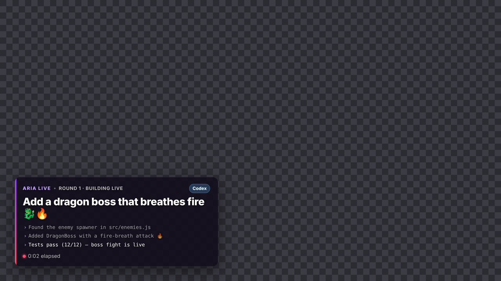

# Aria Live Studio

**Your Twitch chat decides what gets built. Your coding agent builds it, live.**

Viewers propose features in chat (`!idea add a boss fight`), the community votes
(`!vote 2`), Aria turns the winning idea into a concrete development task, the
streamer approves it, and a coding agent (Codex, Claude Code or Aria Code)
implements it in the streamer's repository, while the whole stream watches
progress on an OBS overlay.

```
 Twitch chat ──EventSub──▶ Aria Live server ──▶ Streamer dashboard (approve / reject / cancel)
   !idea  !vote             ideas · ballot ·        │
                            task planning           ├──▶ OBS overlay (votes, task, live build progress)
                                                    │
                                                    └──▶ MCP ──▶ Codex / Claude Code / Aria Code
                                                                 claim · build · report · finish
```

| Streamer dashboard | OBS overlay (transparent, 1920 × 1080) |
|---|---|
|  |  |
|  |  |

The one thing it proves: **viewers propose → the community decides → Aria
organises the work → the streamer approves → an agent builds it → viewers see the
result.**

## Why it is safe to put on stream

- **Viewers can only suggest and vote.** Chat text never reaches a shell. A task
  runs only after the streamer approves it on the dashboard, and the streamer
  can cancel at any time.
- **Agents cannot approve.** Coding agents use a separate agent token. With it
  they can read the round, claim an approved task, report progress and finish
  the task. There is no API or tool for approving, rejecting or voting.
- **Viewer text is untrusted.** Ideas are sanitised (no links, no control or
  bidi characters, length limits). In every prompt they are quoted as untrusted
  data, so "ignore your instructions…" in chat is built as text, not obeyed.
- **The built-in executor is isolated.** When the streamer runs a task from the
  dashboard, it runs in a fresh git worktree on its own branch, with an
  allow-listed tool set and a timeout. It never merges or pushes. Twitch and
  session secrets are removed from its environment.
- **Real data only.** Chat arrives through the Twitch EventSub WebSocket. Local
  testing uses the official Twitch CLI mock server, never fabricated chat.

## Quick start

Requires Node.js 20.11+ (22 recommended) and a Twitch account.

1. **Register a Twitch application** at <https://dev.twitch.tv/console/apps>:
   - Name: `Aria Live Studio` (any unique name)
   - OAuth Redirect URL: `http://localhost:3000/auth/twitch/callback`
   - Category: **Chat Bot**
   - Client Type: **Confidential**

   Copy the Client ID and generate a Client Secret.
2. **Configure and run**

   ```sh
   git clone https://github.com/artheras/aria-live-studio && cd aria-live-studio
   cp .env.example .env        # fill TWITCH_CLIENT_ID / TWITCH_CLIENT_SECRET
   npm install
   npm run build
   npm start                   # http://localhost:3000
   ```

   For development with hot reload, run `npm run dev` with
   `WEB_DEV_URL=http://localhost:5173` in `.env`.
3. **Sign in** at <http://localhost:3000> with the Twitch account you stream
   from. Aria subscribes to your channel's chat (`channel.chat.message`).
4. **Add the overlay to OBS.** On the dashboard, click **Overlay URL**, then in
   OBS add a *Browser Source*, paste the URL, and set it to 1920 × 1080. The
   background is transparent.
5. **Connect your coding agent** (next section). Alternatively, set
   `ARIA_LIVE_EXECUTOR` and `TARGET_REPO` to let the dashboard run tasks itself
   in an isolated worktree.

### Planning with a model

Aria writes the task's user story, acceptance criteria, steps and risks with:

- **Claude** when `ANTHROPIC_API_KEY` is set (default `claude-opus-5-5`; override
  with `ANTHROPIC_MODEL`, and `ANTHROPIC_EFFORT`, default `medium`). The answer is
  constrained to the task schema with structured outputs, and a declined request
  is re-run server-side on Anthropic's recommended fallback model.
- **An OpenAI-compatible model** when `OPENAI_API_KEY` is set (`OPENAI_BASE_URL`,
  `ARIA_LIVE_MODEL`).
- Otherwise a deterministic **template plan**, labelled as such on the dashboard
  and overlay.

`ARIA_LIVE_PLANNER=anthropic|openai|template` forces a choice. Every plan, from
any source, is validated against the same limits before the streamer sees it,
and viewer text is always quoted as untrusted input.

## Chat commands

| Command | Who | What it does |
|---|---|---|
| `!idea <text>` | eligible chatters, while ideas are open | proposes a feature; sending the same idea again counts as a +1 |
| `!idea +<n>` or `!+1 <n>` | eligible chatters, while ideas are open | +1 idea #*n* (once per idea, not your own) |
| `!vote <n>` | eligible chatters, during the vote | votes for ballot number *n*; voting again changes your vote |
| `!ideas` | anyone | Aria replies with the current ballot or latest ideas |
| `!aria` | anyone | help (moderators also get the moderator commands) |
| `!aria open [theme]` | moderators, broadcaster | opens a round when none is running (like **Open round** / **Next round**) |
| `!aria vote` / `!aria close` | moderators, broadcaster | starts / closes the vote |
| `!aria extend <5-300>` | moderators, broadcaster | adds seconds to a timed vote |
| `!aria hide <n>` | moderators, broadcaster | hides idea #*n* while collecting, ballot #*n* while voting |

"Eligible" is set per action in **Settings** (*Who can submit ideas*, *Who can
vote*): everyone (default), subscribers (founders count), or VIPs & mods. VIPs,
moderators and the broadcaster are always eligible. Ineligible attempts are
counted on the dashboard, and each chatter is told at most once per round.
Moderator commands from anyone else are ignored silently, and the activity feed
names the moderator. Chat can never plan, approve, reject, run or cancel a
build: `!aria approve` gets "Approvals happen on the dashboard".

The streamer drives the round from the dashboard: **Open round → Start vote →
Close vote → Plan with Aria → Approve → Build → Next round.**

## Connect a coding agent (Codex · Claude Code · Aria Code)

The dashboard's **Connect a coding agent** panel shows your agent token and
ready-to-paste snippets. The agent uses five MCP tools:

| Tool | |
|---|---|
| `live_status` | round, ballot, votes, winner, task and execution state |
| `live_wait_for_task` | waits until the streamer approves the winning task |
| `live_claim_task` | claims it; the overlay now shows who is building |
| `live_report_progress` | one line per milestone, shown on stream |
| `live_complete_task` | finishes with a summary and the changed files |

The `aria-live` skill (`plugin/skills/aria-live/SKILL.md`) teaches the agent
this loop and its rules.

**Claude Code** installs the plugin from this repository:

```sh
export ARIA_LIVE_TOKEN=<agent token>   # and ARIA_LIVE_URL if not http://localhost:3000
claude plugin marketplace add artheras/aria-live-studio
claude plugin install aria-live@aria-live-studio
```

Or add only the MCP server:
`claude mcp add aria-live -e ARIA_LIVE_TOKEN=<token> -- node /path/to/aria-live-studio/plugin/mcp/aria-live-mcp.mjs`

**Codex**: append [`plugin/codex.toml`](plugin/codex.toml) to `~/.codex/config.toml`
(fix the path and token), and copy the skill:
`cp -r plugin/skills/aria-live ~/.codex/skills/`.

**Aria Code**: merge [`plugin/mcp.json`](plugin/mcp.json) into
`~/.aria-code/mcp_servers.json` (fix the path and token), and copy
`plugin/skills/aria-live` into your skills folder.

Then, in the agent, in your game's repository: *"Build what chat voted for."*

## Local end-to-end test

`scripts/e2e-local.mjs` runs the real server, the real MCP bridge and a real
browser against local stand-ins for Twitch (they live only in the script; the
product has no mock mode):

```sh
npm install
node scripts/e2e-local.mjs                  # phases A, B and C (~2 min)
node scripts/e2e-local.mjs --phases=A       # or any of A,B,C; --skip-build, --keep
```

- **A: official Twitch CLI mock.** Starts `twitch event websocket start-server
  --require-subscription` and a small fake of the Twitch auth (`/oauth2/*`) and
  Helix APIs that forwards `POST /eventsub/subscriptions` to the CLI. Logs in
  through the real OAuth redirects, checks the server connects with the CLI's
  session id and subscribes within 10 s, then drives the CLI: `close
  --reason=4006` and `keepalive --enabled=false` (reconnect with backoff and a
  new subscription), and `reconnect` (moves to the new session without
  resubscribing).
- **B: chat flow.** The CLI cannot send `channel.chat.message` (`event trigger`
  does not support it, and its subscription endpoint rejects the type, so phase
  A registers a stand-in type on the same session). Phase B therefore uses a
  minimal EventSub WebSocket server in the script that sends real-format chat
  notifications: `!idea` (duplicates, a link, emoji, too long), `!vote`
  (changes, invalid numbers), dashboard REST with CSRF (open, vote, close, plan,
  approve), then `plugin/mcp/aria-live-mcp.mjs` over stdio (wait, claim, report
  progress, complete), a cancel while an agent holds the task, and one run of
  the built-in executor with a fake `aria-code` in a temporary git repository.
- **C: screenshots.** `npm run build`, then Chromium (via `playwright-core`;
  set `CHROMIUM_PATH` if no Playwright browser is installed) saves the
  dashboard, overlay, history and login screens to `docs/screenshots/`.

Requires the [Twitch CLI](https://dev.twitch.tv/docs/cli/) for phase A (`twitch`
on `PATH`, or `--twitch-cli=PATH`).

## Development

```sh
npm test          # server, MCP and web unit/integration tests
npm run typecheck
```

| Path | |
|---|---|
| `packages/shared` | the protocol: state, REST actions, agent API types |
| `packages/server` | Twitch OAuth + EventSub, round engine, planner, executors, REST/WebSocket API |
| `packages/web` | streamer dashboard, OBS overlay, session history (React + Vite) |
| `packages/mcp` | MCP bridge for coding agents |
| `plugin/` | Claude Code plugin + marketplace, Codex and Aria Code configs, the `aria-live` skill |

## License

Apache-2.0
